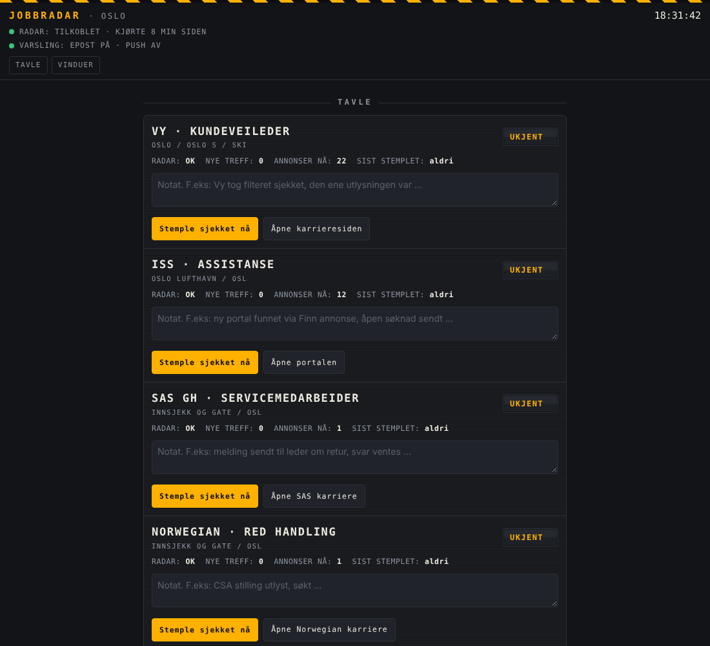

# Job Radar

A small monitoring system that watches five employers' career sites around the clock and emails me only when a job I actually want shows up: passenger facing airport roles (check in, gate, ticket and service desks, PRM assistance) at Oslo Airport Gardermoen, plus customer guide roles at Vy.

**Live dashboard:** https://facha003.github.io/job-radar/



## Why

Airport employers hire in short batches, often with deadlines of a few weeks, and the posting titles are vague ("Har du lyst på en aktiv arbeidshverdag?"). Generic job alerts either miss these or flood you with cleaning, ramp and management roles at other airports. This radar is built to be quiet unless something is genuinely relevant.

## How it works

```
GitHub Actions (cron every 10 min, paced to one real check per ~30 min)
  └─ job_radar.py
       ├─ reads each source: HTML career pages (requests + BeautifulSoup),
       │    the Webcruiter JSON API (Vy), the SuccessFactors job feed (Norwegian)
       ├─ filters each listing: location → exclusions → role keywords
       │    └─ vague titles: opens the ad and checks the role in the body
       ├─ new matches → one GitHub issue per job → email notification
       ├─ deadline reminders 3 days and 1 day before, as a comment on the job's issue
       ├─ docs/frister.ics: a calendar feed of the deadlines
       ├─ a site that fails 5 checks in a row → warning mail, and a mail when it is back
       ├─ weekly "radar alive" mail with live listing counts per company
       ├─ remembers every wanted posting in docs/jobs.json: first seen, deadline, open or closed
       └─ commits seen.json + docs/status.json + docs/jobs.json
GitHub Pages
  └─ docs/ (plain HTML, CSS and JavaScript, no build step, departure board style)
       ├─ every wanted job with a deadline countdown
       ├─ a private application tracker: status and notes stay in the browser
       ├─ employer board generated from status.json, history of closed postings
       └─ installs to the phone's home screen and opens offline
```

| Target | Source | What counts as a match |
|---|---|---|
| SAS Ground Handling | SuccessFactors search, Gardermoen | Servicemedarbeider, check in, gate, desks |
| Norwegian (Red Handling) | SuccessFactors job feed (hosted by SAP) | Customer service, CSA, check in, gate, ticket desk at OSL |
| Widerøe Ground Handling | jobbiwideroe.no → Jobbnorge | Flyekspeditør, passenger roles at OSL |
| ISS | ReachMee portal | PRM assistance at Gardermoen, never cleaning |
| Vy | Webcruiter API | Kundeveileder and related roles |

## Design choices worth noting

**Filter on the whole listing row, not just the title.** ISS titles are marketing lines, but the row also prints the real role category ("Renholdsmedarbeider Stjørdal"). Matching on the row is what keeps cleaning jobs out.

**Prefer a noisy alert to a silent miss.** If an ad can't be read, the radar still alerts, tagged "check the role yourself". Missing the one right posting costs more than one extra email.

**Detect a quietly broken scraper.** Each target has a layout sanity check (no job links at all → failure, shown on the dashboard, warning after 5 in a row). The weekly mail also flags any company whose live listing count drops to 0 or halves since last week.

**Tested against real history.** The filter was replayed against real past postings (SAS summer temps Feb 2026, ISS PRM Feb 2026, Norwegian customer service OSL Mar 2024, plus ramp, cargo, engineering and office roles that must stay quiet). That replay found and fixed one real miss.

**Go around a blocked door, not through it.** In November 2026 Norwegian's career site started answering GitHub's servers with a Cloudflare challenge (HTTP 403) on every page, feed and sitemap. Rather than disguise the scraper, the radar now reads the public job feed SAP hosts for the same recruiting system. That feed has no location field, so a role match that never mentions Oslo or Gardermoen still alerts, tagged "location not confirmed", unless its title plainly names another airport.

**An alert only counts once it is delivered.** A posting is marked as seen after a channel has accepted the alert. If delivery fails, it stays unseen and alerts again on the next run. Warnings about a broken site travel the same road as job alerts, so they cannot be lost quietly either.

**Closing the issue is the off switch.** Each job gets its own GitHub issue. Deadline reminders go there as comments, and stop when the issue is closed. The radar never needs to know whether I applied: that stays in my browser, and a closed issue in a public repo says nothing about why it was closed.

**One broken site never stops the others.** Any error in one target, including a bug in its parser, is counted as that target's failure and shown on the dashboard with the reason. The rest of the run carries on.

**No secrets needed.** Alerts go out as GitHub issues, so GitHub's own notification email does the delivery. SMTP and ntfy push are supported if configured as repository secrets.

## Running it

Everything runs in GitHub Actions. From the Actions tab, "job radar" can be started manually with:

| Input | Effect |
|---|---|
| `dry_run` | Read every source, print every listing and what would alert. Sends nothing, saves nothing |
| `dry_run_target` | Limit the dry run to one company |
| `heartbeat` | Send the weekly "radar alive" mail now |
| `test_alert` | Send a fake alert through the real email path |

GitHub's free scheduler skips most of the slots it is asked for, so hours can pass between runs. The workflow therefore asks every 10 minutes and skips a scheduled run when the last check is under 25 minutes old. Manual runs always go through.

Locally: `pip install -r requirements.txt`, then

| Command | Effect |
|---|---|
| `python job_radar.py` | Preview: reads every source and prints what is open now. Sends nothing, saves nothing |
| `python job_radar.py --dry-run` | Same, plus every listing each source returned |
| `python job_radar.py --write` | A real run, as GitHub does it: alerts and saves state |
| `python job_radar.py --test` | Sends a test alert through the configured channels |

## Tests

```
pip install -r requirements-dev.txt
pytest
```

The suite runs without network access. It covers the filters for each site (wanted roles alert, ramp, cargo, cleaning and other airports stay quiet), all three source types, alert delivery and retry, failure warnings, the weekly mail and the command line. GitHub runs it on every change to the code or config.

Targets, keywords and exclusions live in `config.json`. Setup notes for GitHub Pages (Norwegian) are in `NETTSIDE_OPPSETT.md`.
